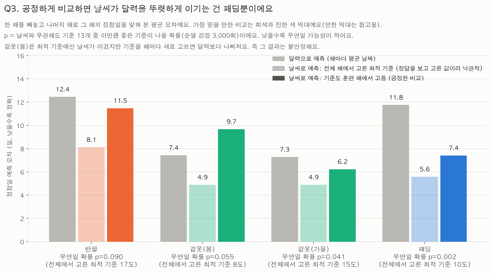

# 사람들은 달력을 보고 옷을 살까, 바뀐 날씨를 느끼고 살까?

옷 검색량(반팔·겉옷·패딩)과 서울 기온의 일간 시계열(2017–2026)을 맞대어, **소비 관심의 시기가 달력을 따르는지 날씨를 따르는지** 검증한 데이터 분석 프로젝트입니다.

> 전체 근거, 방법, 한계는 **[REPORT.md](REPORT.md)** 에 있습니다. 이 문서는 개요, 핵심 결과, 실행 방법을 담았습니다.

## 핵심 결과

| 질문 | 답 (요약) |
|---|---|
| Q1·Q2 언제, 몇 도에서 많이 찾나? | 반팔 5월 초(약 20℃), 겉옷 3월 초(약 8℃)와 10월 중순(약 13℃), 패딩 11월 중순(약 4℃) |
| Q3 날씨가 달력보다 정점일을 잘 맞히나? | **패딩만 뚜렷하게 그렇다** (예측 오차 11.8일 → 7.4일, 우연일 확률 p=0.002). 겉옷(가을)은 약한 지지, 반팔은 판단 불가, 겉옷(봄)은 불안정 |
| Q4 반응형인가 선행형인가? | 패딩은 기온이 약 10℃ 아래로 내려간 **뒤** 정점(반응형에 가까움). 단, 시차의 크기(+0.9~+8.6일)는 설정에 따라 변함 |
| Q5 겉옷 관심과 기온 계절 | 가을 겉옷 관심의 시작은 기온 가을 시작과 함께 움직임(r=0.69). 겉옷을 안 찾는 기간의 단축(-2.9일/년)은 기온으로 설명되지 않음 |



**검증을 어떻게 했나.** 기준 기온을 정답을 보고 고르면 날씨 모델이 유리해지는 문제를 막기 위해, 기준 기온까지 훈련 해에서만 고르는 *중첩 검증*과 *순열 검정*(3,000회)을 추가했습니다. 이 과정에서 처음 "가장 날씨형"으로 보였던 겉옷(봄)은 달력보다 나쁜 결과로 바뀌었고, 결론도 그에 맞게 고쳤습니다.

**주의.** 서울 한 지점, 항목마다 9~10개 연도의 탐색적 분석이며 인과를 증명하지 않습니다. 검색은 구매와 같지 않습니다. 자세한 한계는 REPORT.md 7장.

## 폴더 구성

```
analysis.py        분석 코드 (실행하면 images/, outputs/ 를 다시 만듭니다)
requirements.txt   필요한 라이브러리
REPORT.md          분석 리포트 (배경, 가설, 방법, 결과, 한계, AI 사용 로그, 참고문헌)
data/              원본 데이터 2개
images/            그래프 7개
outputs/           표(csv)와 summary.txt (콘솔 출력 전체)
```

## 실행 방법 (Mac)

```bash
python3 -m venv .venv
source .venv/bin/activate
pip install -r requirements.txt
python analysis.py
```

Python 3.12에서 확인했습니다. 실행하면 `images/`에 그래프 7개, `outputs/`에 표와 `summary.txt`가 만들어집니다. 순열 검정은 난수 시드가 고정되어 같은 결과가 재현됩니다.

그래프의 한글이 네모(□)로 보이면 `pip install koreanize-matplotlib` 을 한 번 실행한 뒤 다시 돌려 주세요. (Mac은 보통 AppleGothic을 자동으로 찾아서 씁니다.)

## 산출물

| 파일 | 내용 |
|---|---|
| `outputs/summary.txt` | 콘솔 출력 전체 (데이터 확인, 정제, Q1~Q5, 검증 보강, 변화율) |
| `outputs/q1_q2_peaks.csv` | 해마다 정점일과 그날의 기온 |
| `outputs/q3_q4_threshold_sweep.csv` | 기준 기온별 날씨 모델 vs 달력 모델 |
| `outputs/q3_robustness.csv` | 공정한 비교(중첩 검증)와 순열 검정 p값 |
| `outputs/robustness_smoothing.csv` | 이동평균 길이(3·7·14일) 민감도 |
| `outputs/q5_seasons.csv` | 겉옷 관심 날짜와 기온 계절 날짜 |
| `outputs/yearly_level.csv`, `q1_monthly_mean.csv`, `outliers.csv` | 연평균 변화율, 월평균, 이상치 목록 |

## 데이터

| 데이터 | 출처 | 수집 방법 | 기간 |
|---|---|---|---|
| 서울 일평균·최저·최고 기온 | 기상청 기상자료개방포털 > 종관기상관측(ASOS) > 일자료, 서울(지점 108) | 포털에서 직접 CSV 다운로드. 한 번에 최대 120개월까지만 조회돼서 기간을 맞춰 받음. 다운로드일 2026-10-18 | 2017-01-01 ~ 2026-10-17 (3,577일) |
| 옷 검색량 (반팔·겉옷·패딩) | 네이버 데이터랩 > 검색어트렌드 | 주제어 3개를 **한 번에** 조회해서 엑셀로 다운로드. 일간, 범위=통합검색(합계), 성별·연령 전체 | 2016-01-01 ~ 2026-10-17 (3,943일) |

- 주제어별 검색어: 반팔 = 반팔, 반소매, 민소매 / 겉옷 = 겉옷, 외투, 아우터 / 패딩 = 패딩 (코트는 넣지 않았습니다)
- 검색량 지수는 **조회 하나 안에서 가장 큰 값을 100으로 맞춘 상대값**입니다. 세 주제어를 같이 조회해서 서로 같은 기준을 쓰지만, 값 자체가 실제 검색 횟수는 아닙니다.
- 분석은 기온 데이터가 시작되는 2017년부터 사용합니다. 2026년은 10월 17일까지라 연 단위 비교에서는 뺍니다.

### 라이선스·이용 주의

원본 데이터는 각 사이트의 이용약관을 따릅니다. 기상청 자료와 네이버 데이터랩 자료를 다시 배포하거나 상업적으로 쓰기 전에 각 사이트의 이용 조건을 직접 확인해 주세요. 이 저장소는 학습용 과제이고, 데이터 파일은 재현을 돕기 위해 넣어 둔 사본입니다.
