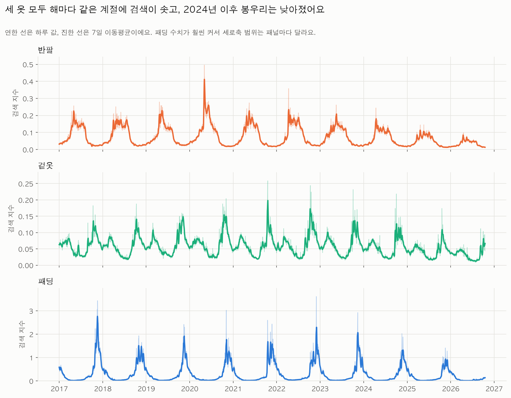
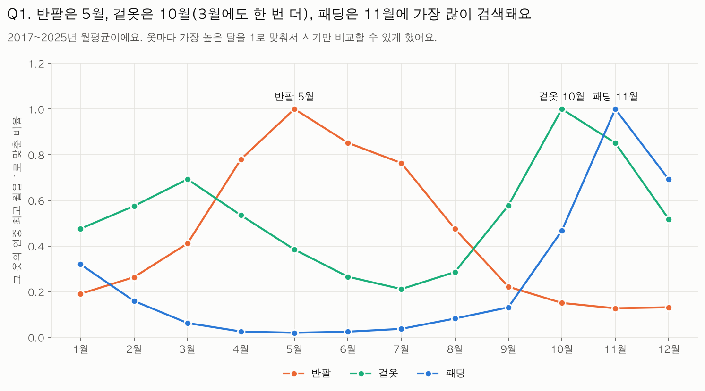
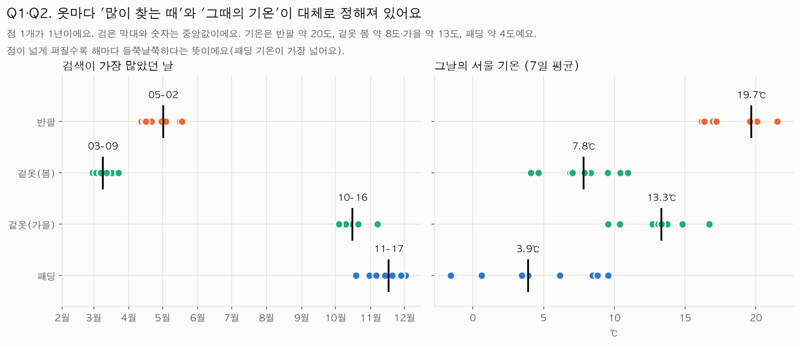
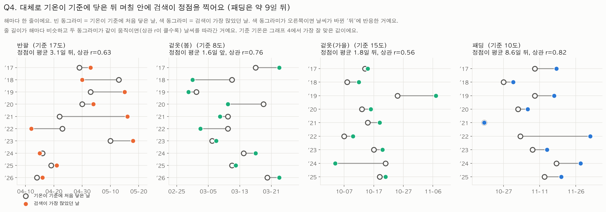
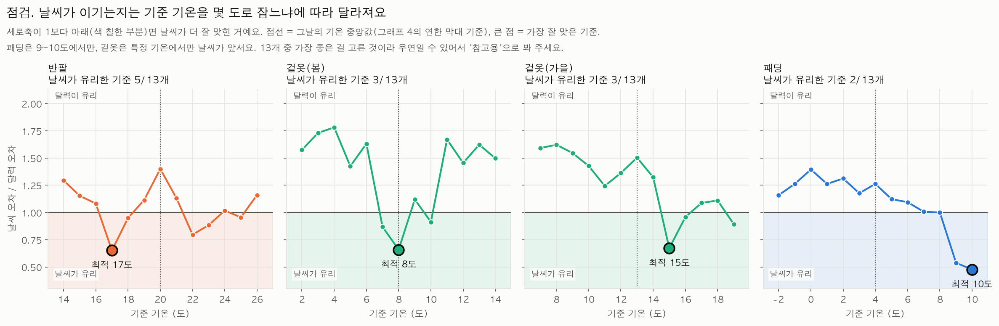
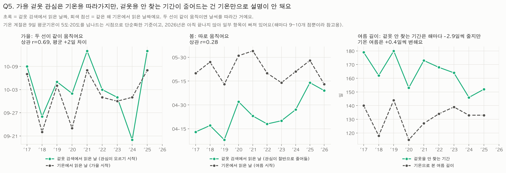
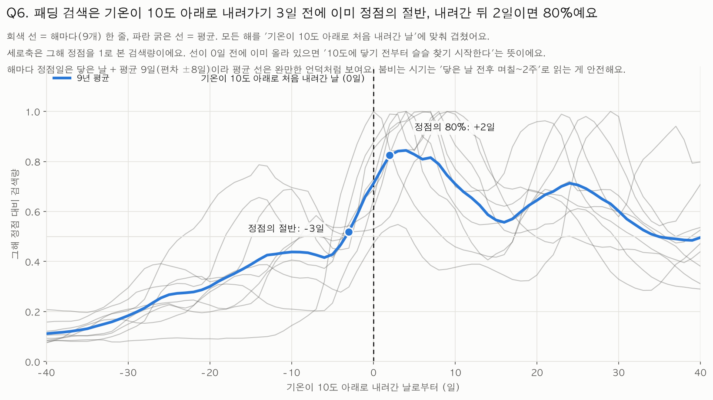
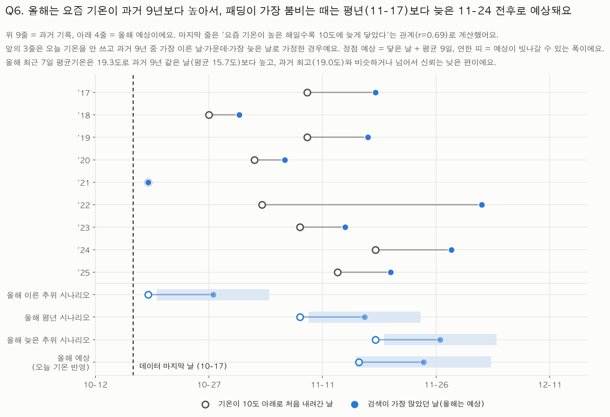

# 환절기 옷, 수요는 언제 생길까? 날짜일까, 기온일까?

**옷 검색량(반팔·겉옷·패딩)과 서울 기온의 시계열로 본 환절기 의류 수요 시기 분석 (2017–2026)**

---

## 요약

**문제.** 이 프로젝트는 "사람들은 계절이 바뀔 때 언제 옷을 살까?"라는 궁금증에서 시작했다. 옷을 파는 쪽이라면 수요가 생기는 시점(검색이 많아지는 때)보다 앞서 환절기 옷을 출시하거나 판매를 시작하는 편이 맞을 것이라고 보았고, 그러려면 다음 질문에 답해야 한다.

1. 수요가 생기는 때는 언제인가?
2. 그 시기는 **날짜(달력)** 로 정해지는가, 아니면 **기온(날씨)** 을 따라 움직이는가?
3. 기온을 따른다면, 기온이 예전과 달라진 요즘은 그 시기가 언제 오는가?

**방법.** 네이버 데이터랩의 일간 검색량(반팔·겉옷·패딩)과 기상청 서울 일평균기온을 2017년부터 2026년 10월까지 맞대어 보았다. 해마다 검색이 가장 많았던 날(정점일)을 찾고, "매년 같은 날짜"라고 가정하는 **달력 모델**과 "기온이 기준에 닿은 날 + 평균 시차"로 예측하는 **날씨 모델**이 정점일을 얼마나 잘 맞히는지 비교했다. 기준 기온을 정답을 보고 고르는 낙관 편향을 막기 위해 **기준 기온까지 훈련 해에서만 고르는 공정한 검증**과 **순열 검정**을 추가했다.

**핵심 결과.**

1. **옷마다 많이 찾는 때와 그때의 기온이 대체로 정해져 있다.** 정점일의 중앙값은 반팔 5월 2일(약 20℃), 겉옷 3월 9일(약 8℃)과 10월 16일(약 13℃), 패딩 11월 17일(약 4℃)이다. 같은 겉옷이 봄과 가을에 5℃ 넘게 다른 기온에서 정점을 찍는다.
2. **날씨 연동이 견고하게 확인된 것은 패딩뿐이다.** 공정한 검증에서 패딩의 예측 오차는 달력 11.8일, 날씨 7.4일(오차비 0.63)이고 우연일 확률은 p=0.002이다. 겉옷(가을)은 약한 지지(0.85, p=0.041), 반팔은 판단 불가(0.92, p=0.090)이며, 겉옷(봄)은 처음에 날씨와 가장 잘 맞아 보였으나 공정한 검증에서는 달력보다 나빠져(1.30) 불안정한 결과로 판단했다.
3. **패딩은 기온이 약 10℃ 아래로 내려간 뒤에 정점을 찍는 '반응형'에 가깝다.** 다만 평균 시차는 이동평균 길이에 따라 +0.9일에서 +8.6일로 움직이므로 크기는 불확실하고, 부호(뒤)만 일관적이다.
4. **가을 겉옷 관심의 시작은 기온으로 본 가을 시작과 함께 움직이지만**(r=0.69, 평균 +2일), **겉옷을 안 찾는 기간이 해마다 약 2.9일씩 짧아지는 것은 기온 변화(여름 길이 +0.4일/년)로 설명되지 않는다.** 검색량 수준 자체가 2025년에 전년 대비 19~27% 줄어든 점이 함께 작용했을 가능성이 있다.
5. **이 결과를 올해에 적용하면(Q6):** 올해 서울 기온은 10월 17일 기준 아직 10℃에 닿지 않았고, 요즘 기온(최근 7일 평균 19.3℃)이 과거 9년 같은 날 평균(15.7℃)보다 높다. 요즘 기온이 높은 해일수록 10℃에 늦게 닿았던 관계(r=0.69)를 쓰면 올해 10℃ 도달은 11월 16일 전후, 패딩 검색 정점은 **11월 24일 전후**(대략 11월 15일~12월 3일)로 예상된다. 평년 기준(11월 17일)보다 약 일주일 늦다. 이 예상은 9개 연도로 만든 것이라 신뢰가 낮고, 12월 이후 실제 검색량으로 확인할 수 있다. 가격은 보지 않았으므로 "언제 사면 싼가"가 아니라 "언제 가장 붐비는가"까지만 말한다.

**의미와 한계.** 서울 한 지점, 항목마다 9~10개의 정점일이라는 작은 표본에 기초한 탐색적 분석이다. 검색 관심은 실제 구매와 같지 않고, 인과를 증명하지 않는다. 결론은 "패딩에서는 날씨 연동의 증거가 분명하고, 나머지는 현재 자료로 판단하기 어렵다"이다.

---

## 목차

1. [배경과 문제의식](#1-배경과-문제의식)
2. [연구 질문과 가설](#2-연구-질문과-가설)
3. [데이터](#3-데이터)
4. [분석 방법](#4-분석-방법)
5. [결과](#5-결과)
6. [종합 논의](#6-종합-논의)
7. [한계와 타당성 위협](#7-한계와-타당성-위협)
8. [결론과 후속 연구](#8-결론과-후속-연구)
9. [용어 설명](#9-용어-설명)
10. [재현 방법](#10-재현-방법)
11. [AI 사용 로그와 검증 기록](#11-ai-사용-로그와-검증-기록)
12. [참고문헌](#12-참고문헌)

---

## 1. 배경과 문제의식

### 1.1 왜 이 질문인가

출발점은 "사람들은 계절이 바뀔 때 언제 옷을 살까?"이다. 옷을 판매하는 입장에서는 수요가 생긴 뒤에 대응하기보다, 수요가 생기기 전에 환절기 의류를 출시하거나 판매를 시작하는 것이 유리할 것이라는 가정이 자연스럽다. 이 가정을 실행하려면 수요가 생기는 시기를 알아야 하고, 그 시기가 날짜로 정해지는지 기온을 따라 움직이는지를 구분해야 한다. 기온을 따른다면, 기온이 예전과 달라진 요즘은 그 시기가 언제 오는지도 알아야 한다. 이 프로젝트는 이 질문들을 검색량과 기온 데이터로 확인하는 것이 목적이다.

옷은 날씨에 가장 민감한 소비재 가운데 하나다. 그런데 "언제 살까"를 결정하는 단서는 두 가지로 나뉠 수 있다. 하나는 **달력**이다. 4월이니 반팔을, 10월이니 겉옷을 준비하는 식이다. 다른 하나는 **날씨**이다. 갑자기 추워진 날 패딩을 찾아보는 식이다. 이 둘은 실무에서도 다른 처방으로 이어진다. 달력이 지배적이라면 시즌 상품은 고정된 일정에 맞춰 편성하면 되지만, 날씨가 지배적이라면 기온을 신호로 삼아 노출과 알림의 시점을 움직여야 한다.

### 1.2 기후가 달라지고 있다는 배경

기상청 보도자료 [7]에 따르면 1912~1940년 대비 1991~2020년에 봄은 17일 일찍 시작하고(3월 18일 → 3월 1일), 여름은 11일 일찍 시작하며(6월 11일 → 5월 31일), 가을은 9일 늦게 시작한다(9월 17일 → 9월 26일). 여름은 약 20일 길어졌고 겨울은 약 22일 짧아졌으며, 최근 30년의 여름 길이는 118일이다. 계절의 시기와 길이가 움직이고 있다면, 계절 소비의 시기도 따라 움직이는지가 자연스러운 의문이 된다. 이 프로젝트는 100년 규모의 변화를 직접 검증하지 않고, 최근 10년 안에서 해마다의 기온 변동이 소비 관심의 시기 변동과 연결되는지를 본다.

### 1.3 선행 연구

- **날씨가 소비에 미치는 영향은 존재하지만 크지 않고, 시기를 옮기는 성격이 강하다.** Starr-McCluer [2]는 월별 소매판매 자료로 이상 기후가 판매 변동을 설명하는 데 "보통 수준이지만 유의한" 역할을 하며, 지연 효과가 당초 효과를 상쇄하는 경우가 많다고 보고했다. 날씨는 소비의 총량보다 **시점**을 옮긴다는 해석이 가능하며, 이는 본 연구가 "정점일"이라는 시점 지표를 쓰는 이유이기도 하다.
- **의류 판매에서 기온 이상의 영향을 분리하려는 시도가 있다.** Bertrand와 Brusset [3]는 프랑스 의류 산업의 판매 부진 상황에서 기온 이상이 판매에 미치는 영향을 판매 실적에서 분리하는 통계적 방법을 제안했다.
- **사람은 현재 날씨에 과도하게 반응해 구매한다.** Conlin, O'Donoghue, Vogelsang [1]은 카탈로그 주문 자료에서, 주문일의 날씨가 구매 결정에 과도하게 반영되는 **투영 편향**(projection bias)을 확인했다. 사람들이 미래의 선호가 현재와 달라질 수 있음은 알지만 그 차이의 크기를 과소평가한다는 것이다. 이 연구는 본 프로젝트의 "날씨를 느끼고 반응해서 산다"는 **반응형 가설**의 이론적 근거가 된다.
- **검색 데이터는 현재의 경제 활동을 추정하는 데 쓰일 수 있다.** Choi와 Varian [4]은 구글 검색 데이터가 소매 판매 등 여러 경제 시계열의 현재 수준을 추정하는 데 도움이 된다고 보였다. 본 연구가 검색량을 소비 관심의 대리 지표로 쓰는 근거이지만, 네이버 의류 검색에 대한 직접 검증은 수행하지 않았다(7장).

### 1.4 이 프로젝트의 위치

위 연구들은 주로 판매량이나 판매액의 **크기**에 대한 날씨의 영향을 다룬다. 본 프로젝트는 일간 검색량이라는 공개 자료로, 옷 종류별 소비 관심이 **언제 정점에 이르는지**와 그 시점이 해마다 기온을 따라 움직이는지를 살핀다. 결과는 심리학적 해석(반응형 대 선행형)과 연결하되, 심리 기제를 직접 측정한 것은 아니다.

---

## 2. 연구 질문과 가설

**문제의식의 흐름과 세부 질문의 대응.** 요약의 세 질문은 아래 Q1~Q6으로 나누어 확인한다.

| 핵심 질문 | 세부 질문 |
|---|---|
| ① 수요는 언제 생기는가? | Q1, Q2 |
| ② 날짜로 정해지는가, 기온을 따르는가? | Q3, Q4 |
| ③ 기온이 달라진 요즘은 언제 오는가? | Q5, Q6 |

| 질문 | 가설 | 가설이 맞다면 관찰될 것 |
|---|---|---|
| **Q1** 반팔·겉옷·패딩은 각각 언제 가장 많이 검색되는가? | (기술 질문) | 옷마다 뚜렷한 계절 정점 |
| **Q2** 그때의 기온은 몇 도인가? 옷마다 "사는 기온"이 있고 해마다 비슷한가? | **H3** 옷마다 정점일의 기온은 해마다 비슷하다 | 정점일 기온의 표준편차가 작다 |
| **Q3** 더위·추위가 빨리 또는 늦게 온 해에는 검색 정점도 따라 움직였는가? (날씨 대 달력) | **H1** 날씨 모델이 달력 모델보다 정점일을 더 잘 맞힌다 | 공정한 검증에서 오차비 < 1, 낮은 p값 |
| **Q4** 날씨가 바뀐 뒤에 사는가, 바뀌기 전에 미리 사는가? | **H2** 정점은 기온이 기준에 닿은 뒤에 온다(반응형) | 평균 시차가 양수이고 설정을 바꿔도 부호가 유지됨 |
| **Q5** 겉옷 관심의 시작·종료와 기온으로 본 계절 길이는 해마다 어떻게 변했는가? | **H4** 기온으로 본 계절의 시기와 길이가 겉옷 관심의 시기와 같이 움직인다 | 두 날짜 계열의 상관이 높고 추세 방향이 같다 |
| **Q6** (활용) 패딩만 날씨와 연동된다면, 올해 패딩은 언제 가장 붐빌까? | **H5** 요즘 기온이 높은 해일수록 기온이 10℃에 늦게 닿고, 패딩 정점도 늦어진다 | 같은 날짜의 최근 기온과 10℃ 도달일의 상관이 양수이고, 예측 오차가 평년 날짜 예측보다 작다 |

**날씨와 달력을 구분하는 논리.** 기온 도달일과 달력 날짜는 모두 같은 계절 주기를 공유하므로, 해 전체의 모양만으로는 둘을 구분할 수 없다. 그래서 **해마다의 편차**를 이용한다. 달력 요인이 지배적이면 정점일이 매년 비슷한 날짜에 오고, 날씨 요인이 지배적이면 기온이 기준에 늦게 닿은 해에는 정점도 늦어진다.

---

## 3. 데이터

### 3.1 데이터 개요

| 데이터 | 출처 | 변수 | 기간 | 규모 |
|---|---|---|---|---|
| 서울 일 기온 | 기상청 기상자료개방포털, 종관기상관측(ASOS) 일자료, 서울(지점 108) | 일평균·최저·최고기온(℃) | 2017-01-01 ~ 2026-10-17 | 3,577일, 날짜 누락 0, 평균기온 결측 0 |
| 옷 검색량 지수 | 네이버 데이터랩 검색어트렌드 (통합검색, 일간, 성별·연령 전체) | 반팔·겉옷·패딩 각 지수 | 2016-01-01 ~ 2026-10-17 (분석은 2017년부터) | 주제어 3개 × 3,943일, 결측 0 |

- **주제어별 검색어:** 반팔 = 반팔, 반소매, 민소매 / 겉옷 = 겉옷, 외투, 아우터 / 패딩 = 패딩. 겉옷에는 코트를 넣지 않았다.
- **수집:** 두 자료 모두 직접 내려받았다(2026-10-18). 기상청 일자료는 한 번에 최대 120개월까지만 조회되어 기간을 맞춰 받았다. 데이터랩은 세 주제어를 **한 번에** 조회했다.
- **라이선스:** 두 자료는 각 사이트의 이용약관을 따른다. 재배포나 상업적 이용 전에 약관을 확인해야 한다. 저장소의 데이터 파일은 재현을 돕기 위한 사본이다.

### 3.2 검색량 지수의 성격

세 주제어를 한 번에 조회했기 때문에 세 계열은 **같은 척도**를 공유한다. 내려받은 파일에서 패딩의 최댓값이 정확히 100.0이고(2016-10-31), 패딩의 값이 반팔·겉옷보다 약 10배 크다. 이는 지수가 조회 하나 안에서 최댓값을 100으로 맞춘 **상대값**이라는 해석과 일치한다. 따라서 값은 실제 검색 횟수가 아니며, 같은 조회 안의 계열끼리 비교하거나 한 계열의 시기 변화를 보는 데 적합하다. (공식 도움말의 지수 정의 문구는 확인하지 못했다. 7장 참고.)

### 3.3 결측치와 이상치 처리 기준

- **결측치:** 검색량 결측 0, 날짜 누락 0. 기온은 평균기온 결측 0이다. 최저·최고기온에 각 1개 결측이 있으나 분석에 사용하지 않는다.
- **이상치:** 하루 값이 **주변 15일 중앙값의 3배를 넘으면 중앙값으로 대체**했다. 반팔·겉옷은 0개, 패딩은 6개였다(2017-11-18: 9.04 → 2.19, 2018-10-30: 9.23 → 1.17, 4~5월의 작은 값 4개). 목록은 `outputs/outliers.csv`에 있다.
- **이유:** 하루짜리 급등이 "해마다 가장 많이 검색된 날"을 바꾸는 것을 막기 위해서다. 정점은 7일 이동평균으로 찾아 하루 변동의 영향을 추가로 줄였다.
- **분석 구간:** 반팔·겉옷(봄)은 2017~2026년(10개 연도), 겉옷(가을)·패딩은 2017~2025년(9개 연도)을 쓴다. 2026년은 10월 17일까지이므로 연 단위 비교(연평균, 가을·겨울 항목)에서는 뺀다.

---

## 4. 분석 방법

### 4.1 사용한 기법

| 기법 | 쓰임 |
|---|---|
| 이동평균 (검색 7일, 기온 7일) | 하루 변동을 줄이고 해마다 정점일 찾기 |
| 월별 집계 | Q1 계절 모양 |
| 구간별 통계 | 정점일 기온의 중앙값·평균·표준편차 (Q2) |
| 시차와 상관 | 기온 도달일과 정점일의 차이, 연도별 상관 (Q3, Q4) |
| 한 해씩 빼고 예측 (LOO) | 달력 모델 대 날씨 모델의 예측 오차 비교 (Q3) — 시계열 예측 모형의 비교 |
| 중첩 검증 | 기준 기온도 훈련 해에서만 골라 낙관 편향 제거 (Q3) |
| 순열 검정 | 우연일 확률 계산 (Q3) |
| 민감도 분석 | 기준 기온과 이동평균 길이를 바꿔 결론의 안정성 확인 (Q3, Q4) |
| 변화율과 추세 | 연평균 검색량 전년 대비, 계절 길이의 연 추세 (Q5, 한계) |

### 4.2 핵심 정의

- **정점일:** 해마다 정해진 구간 안에서 7일 이동평균 검색량이 가장 큰 날. 구간은 반팔 3/1~8/31, 겉옷(봄) 2/1~4/30, 겉옷(가을)·패딩 9/1~12/31이다. 겉옷은 봄과 가을에 봉우리가 두 번 있어 따로 다룬다.
- **기온 도달일:** 반팔·겉옷(봄)은 7일 평균 기온이 기준 이상으로 **처음 올라온 날**, 겉옷(가을)·패딩은 기준 이하로 **처음 내려간 날**.
- **시차:** 정점일 − 기온 도달일. 양수면 날씨가 바뀐 **뒤**에 정점이 온 것이다.
- **달력 모델:** 한 해를 빼놓은 나머지 해의 **평균 정점 날짜**로 그 해를 예측한다.
- **날씨 모델:** 그 해의 기온 도달일 + 나머지 해의 **평균 시차**로 예측한다.
- **예측 오차와 오차비:** 한 해씩 빼고 맞혀 본 평균 절대 오차(일). 오차비 = 날씨 오차 ÷ 달력 오차이며 1보다 작으면 날씨가 유리하다.

### 4.3 기준 기온 문제와 두 가지 보강

날씨 모델에는 "몇 도에 닿은 날"을 쓸지, 즉 **기준 기온**이 필요하다. 이를 전체 해에서 가장 좋은 값으로 고르면 정답을 보고 고른 셈이라 날씨 모델이 유리해진다. 이를 다음 두 방법으로 보정했다.

1. **중첩 검증(공정한 비교):** 어떤 해를 예측할 때, 그 해를 뺀 나머지 해로만 기준 기온을 고른 뒤 그 기준으로 그 해를 예측한다. 후보는 정점일 기온 중앙값 ±6℃의 13개 기준이다(해당 기온에 닿은 해가 6개 미만인 기준은 제외되어, 패딩은 12개).
2. **순열 검정(우연일 확률):** 해마다의 정점일을 무작위로 섞어 날씨와의 관계를 끊은 뒤, 후보 기준 중 가장 좋은 오차비를 구한다. 이를 3,000번 반복해, 섞은 자료에서 실제 관측값 이상으로 좋은 결과가 나온 비율을 p값으로 삼는다(난수 시드 0). 이 p값은 기준 여러 개를 시험한 것까지 고려한다.

또한 정점을 찾는 이동평균 길이(3·7·14일)를 바꿔 결론이 유지되는지 확인했다.

---

## 5. 결과

### 그래프 1. 검색량의 흐름



- **관찰:** 세 옷 모두 해마다 같은 계절에 봉우리가 솟는다. 2024~2025년으로 갈수록 봉우리가 낮아진다.
- **해석:** 계절성이 강해 시기 분석에 적합한 자료다. 봉우리가 낮아지는 것은 날씨만으로 설명되지 않는다(이 장 끝의 검색량 수준 변화, 7장).

시계열을 세 요소로 나누어 읽으면 이 자료는 다음과 같다. 정량적인 분해(STL 등)는 하지 않았고, 그래프와 표로 구분해 읽었다.

| 요소 | 뜻 | 이 자료에서 |
|---|---|---|
| 트렌드 | 장기적인 오르내림 | 세 옷 모두 2024~2025년에 연평균 지수가 내려감(-19~-27%) |
| 계절성 | 해마다 같은 때 반복되는 모양 | 반팔 5월, 겉옷 3월·10월, 패딩 11월 봉우리 |
| 노이즈 | 위 둘로 설명되지 않는 하루 단위 흔들림 | 하루만 튀는 값(패딩 6개), 7일 이동평균으로 줄임 |

### 그래프 2. 월별 검색 패턴 (Q1)



- **관찰:** 월평균이 가장 높은 달은 반팔 5월(0.167), 겉옷 10월(0.111), 패딩 11월(1.198)이다. 겉옷은 3월(0.077)에 두 번째 봉우리가 있다.
- **해석:** 소비 관심은 계절이 **한창일 때**보다 **시작될 즈음**에 몰린다(반팔은 7~8월이 아니라 5월). 겉옷이 봄과 가을에 두 번 솟는 것은 환절기마다 겉옷 수요가 생기기 때문으로 보인다.

### 그래프 3. 해마다 검색이 가장 많았던 날과 그날의 기온 (Q1·Q2)



| 항목 | 정점일 중앙값 | 가장 이른 ~ 늦은 | 정점일 기온 중앙값 | 평균 | 표준편차 | 범위 | 연도 수 |
|---|---|---|---|---|---|---|---|
| 반팔 | 05-02 | 04-12 ~ 05-18 | 19.7℃ | 18.9 | 2.0 | 16.2 ~ 21.5 | 10 |
| 겉옷(봄) | 03-09 | 02-28 ~ 03-23 | 7.8℃ | 7.8 | 2.2 | 4.1 ~ 10.9 | 10 |
| 겉옷(가을) | 10-16 | 10-04 ~ 11-07 | 13.3℃ | 13.1 | 2.1 | 9.6 ~ 16.7 | 9 |
| 패딩 | 11-17 | 10-19 ~ 12-02 | 3.9℃ | 4.8 | 3.8 | -1.6 ~ 9.6 | 9 |

- **관찰:** 정점일은 반팔이 36일, 패딩이 44일의 폭으로 흔들린다. 정점일 기온의 표준편차는 반팔·겉옷이 약 2℃, 패딩이 3.8℃이다. 같은 겉옷이 봄에는 7.8℃, 가을에는 13.3℃에서 정점을 찍어 5℃ 넘게 차이가 난다.
- **해석 (H3):** 옷마다 어느 정도의 "기온대"가 있어 보이지만 폭이 ±2~4℃로 좁지는 않다. 같은 겉옷이 봄과 가을에 다른 기온에서 정점을 찍는 것은 절대 기온보다 **기온이 오르는 중인지 내리는 중인지**(방향)가 영향을 주었을 가능성을 시사한다. 이 자료로는 방향 효과를 따로 검증하지 못했으므로 가설로만 둔다.

### 그래프 4. 날씨가 달력보다 정점일을 더 잘 맞히는가? (Q3, H1)


막대가 낮을수록 정확하다. 회색은 달력, 진한 색은 기준 기온까지 훈련 해에서 고른 날씨 모델(공정한 비교), 연한 색은 전체 해에서 가장 좋은 기준을 고른 날씨 모델(낙관적이므로 참고용)이다.

| 항목 | 달력 오차 | 날씨 오차 (전체에서 고른 최적 기준) | 날씨 오차 (공정한 비교) | 오차비 (공정) | 우연일 확률 p | 연도 수 |
|---|---|---|---|---|---|---|
| 반팔 | 12.4일 | 8.1일 (17℃) | 11.5일 | 0.92 | 0.090 | 10 |
| 겉옷(봄) | 7.4일 | 4.9일 (8℃) | 9.7일 | **1.30** | 0.055 | 10 |
| 겉옷(가을) | 7.3일 | 4.9일 (15℃) | 6.2일 | 0.85 | 0.041 | 9 |
| 패딩 | 11.8일 | 5.6일 (10℃) | 7.4일 | **0.63** | **0.002** | 9 |

- **관찰:**
  - 패딩만 공정한 비교에서도 날씨가 달력보다 뚜렷하게 정확하다(7.4일 대 11.8일, p=0.002). 네 항목을 동시에 본 것을 반영한 단순 보정(0.05÷4 = 0.0125) 이후에도 패딩만 남는다.
  - 겉옷(가을)은 날씨가 약간 유리하고(0.85) p=0.041이지만 보정 후에는 기준에 못 미친다. 반팔은 0.92로 거의 같고 p=0.090이다.
  - **겉옷(봄)은 전체에서 고른 기준(8℃)에서는 오차가 4.9일로 가장 좋아 보였지만, 해마다 새로 고르면 9.7일로 달력(7.4일)보다 나빠진다.** 해마다 고른 기준 10번 중 8번은 8℃였으나 나머지 2번(10℃, 7℃)에서 큰 오차가 나와 평균을 끌어올렸다. 이 결과는 특정 연도에 민감하다는 뜻이다.
- **해석:** 날씨 연동의 증거는 옷마다 크기가 다르다. 패딩은 견고하고, 겉옷(가을)은 약하며, 반팔은 이 자료로 판단하기 어렵고, 겉옷(봄)은 불안정하다. 분석 초기에 "봄 겉옷이 날씨와 가장 잘 맞는다"고 보았던 판단은 기준을 정답을 보고 고른 데서 온 낙관 편향이었다.

참고로 기준 기온을 정점일 기온 중앙값 그대로 쓰면(반팔 20℃, 겉옷 봄 8℃, 겉옷 가을 13℃, 패딩 4℃) 날씨 오차는 17.4일, 4.9일, 10.9일, 14.8일이고 상관은 -0.23, 0.76, 0.08, -0.08이다. 기준을 어디에 두느냐에 결과가 크게 좌우됨을 보여 준다.

### 그래프 5. 해마다 기온이 닿은 날과 검색 정점일 (Q4, H2)



해마다 한 줄이다. 빈 동그라미는 기온이 기준에 처음 닿은 날, 색 동그라미는 검색이 가장 많았던 날이다. 기준 기온은 전체 해에서 고른 최적값이라 낙관적이다.

| 항목 | 최적 기준 | 상관 r | 평균 시차 (표준편차) | 해석 |
|---|---|---|---|---|
| 반팔 | 17℃ | 0.63 | +3.1일 (10.6) | 공정한 검증을 통과하지 못해 참고용 |
| 겉옷(봄) | 8℃ | 0.76 | -1.6일 (5.5) | 불안정, 참고용 |
| 겉옷(가을) | 15℃ | 0.56 | +1.8일 (7.9) | 약한 지지 |
| 패딩 | 10℃ | 0.82 | +8.6일 (8.2) | 견고한 항목 |

- **관찰:** 패딩은 평균적으로 색 동그라미(정점)가 빈 동그라미(기온 도달)보다 8.6일 뒤에 있다. 시차는 해마다 편차(표준편차 8.2일)가 있다.
- **해석 (H2):** 패딩은 기온이 10℃ 아래로 내려간 **뒤** 검색이 정점에 이르는 반응형에 가깝다. 이는 현재 날씨에 과도하게 반응하는 투영 편향 [1]과 방향이 일치하지만, 그 심리 기제를 직접 측정한 것은 아니다. 추위를 겪어 본 뒤 구매 확신이 서는 지연으로도 읽을 수 있으나 가설일 뿐이다.

### 그래프 6. 기준 기온을 바꾸면 결론이 달라지는가? (Q3·Q4 점검)



세로축은 날씨 오차 ÷ 달력 오차이다. 1보다 아래(색 칠한 영역)면 날씨가 유리하다. 점선은 정점일 기온 중앙값, 큰 점은 가장 잘 맞은 기준이다.

- **관찰:** 시험한 13개 기준 중 날씨가 유리한 기준의 수는 반팔 5개, 겉옷(봄) 3개(7·8·10℃), 겉옷(가을) 3개, 패딩 2개(9·10℃, 패딩은 12개 기준 중)이다. 기준에 따라 평균 시차가 반팔 -68~+20일, 겉옷(봄) -30~+25일, 겉옷(가을) -31~+14일, 패딩 -34~+9일로 움직인다.
- **해석:** 시차의 크기와 심지어 부호까지 기준 기온에 민감하다. 따라서 "며칠 앞서/뒤에"라는 숫자를 기준과 분리해 말할 수 없다. 패딩만 날씨가 유리한 기준이 인접한 9~10℃에 모여 있고 해마다 새로 골라도 거의 같은 기준(9번 중 8번이 10℃)이 선택되었다.

#### 정점일을 찾는 이동평균 길이를 바꿔도 같은가?

가장 잘 맞은 기준에서의 오차비와 상관(`outputs/robustness_smoothing.csv`).

| 항목 | 3일 | 7일 (본 분석) | 14일 |
|---|---|---|---|
| 반팔 | 0.82 (r 0.43, 시차 -0.5) | 0.65 (r 0.63, +3.1) | 0.69 (r 0.53, +4.3) |
| 겉옷(봄) | 0.71 (r 0.64, +0.6) | 0.66 (r 0.76, -1.6) | 0.64 (r 0.70, -0.9) |
| 겉옷(가을) | 0.89 (r 0.18, +0.4) | 0.67 (r 0.56, +1.8) | 0.86 (r 0.43, +9.1) |
| 패딩 | 0.59 (r 0.71, +0.9) | 0.48 (r 0.82, +8.6) | 0.73 (r 0.31, +5.3) |

- **관찰:** 패딩의 오차비는 세 설정 모두 0.75 이하이고 평균 시차의 부호도 모두 양수이지만, 상관은 0.31~0.82, 시차는 +0.9~+8.6일로 크게 움직인다. 겉옷(가을)은 7일에서만 0.67이고 3일·14일에서는 0.86~0.89로 약해진다.
- **해석:** 패딩의 "반응형" 방향은 이동평균 길이에도 유지되지만 크기는 불확실하다. 겉옷(가을)의 지지는 이동평균 길이에 따라 약해져 더 조심스럽게 읽어야 한다. (이 표의 값은 모두 전체 해에서 고른 최적 기준이라 낙관적이다.)

### 그래프 7. 겉옷 관심과 기온으로 본 계절 (Q5, H4)



초록은 겉옷 검색에서 읽은 날짜, 회색 점선은 같은 해 기온에서 읽은 날짜이다. 겉옷은 겨울에도 검색이 많아 "환절기 길이"를 검색만으로 바로 재기 어려웠다. 그래서 "겉옷 관심이 (바닥~정점)의 절반까지 내려온 날(봄) / 정점 이전에 절반 위로 올라선 날(가을) / 겉옷을 안 찾는 기간"으로 다시 정의했고, 기온 계절은 9일 평균기온이 5℃·20℃를 넘나드는 시점으로 단순화했다(기상청 공식 정의와 다를 수 있다).

| 연도 | 겉옷 봄 관심 꺼짐 | 기온 여름 시작 | 겉옷 가을 관심 시작 | 기온 가을 시작 | 겉옷 안 찾는 기간(일) | 기온 여름 길이(일) |
|---|---|---|---|---|---|---|
| 2017 | 04-13 | 05-20 | 10-09 | 10-07 | 179 | 140 |
| 2018 | 04-17 | 05-27 | 09-26 | 09-22 | 162 | 118 |
| 2019 | 04-08 | 05-13 | 10-05 | 10-04 | 180 | 144 |
| 2020 | 05-02 | 05-31 | 10-02 | 09-23 | 153 | 115 |
| 2021 | 04-23 | 06-03 | 10-13 | 10-08 | 173 | 127 |
| 2022 | 04-18 | 05-20 | 10-03 | 10-01 | 168 | 134 |
| 2023 | 04-20 | 05-14 | 10-01 | 09-30 | 164 | 139 |
| 2024 | 04-27 | 05-21 | 09-20 | 10-01 | 146 | 133 |
| 2025 | 05-14 | 05-28 | 10-13 | 10-08 | 152 | 133 |
| 2026 | 05-09 | 05-13 | - | - | - | - |

- **관찰:**
  - 가을: 겉옷 관심 시작일과 기온 가을 시작일의 차이는 평균 +2.0일(해마다 -11~+9일)이고 상관은 r=0.69(n=9)이다.
  - 봄: 겉옷 관심이 줄어든 날과 기온 여름 시작일의 상관은 r=0.28(n=10)로 약하다. 관심 꺼짐일은 2017~2019년 4월 초·중순에서 2025~2026년 5월 초·중순으로 늦어졌다.
  - 길이: 연 추세(직선 기울기, n=9~10)는 기온으로 본 봄 -0.6일/년, 여름 +0.4일/년, 가을 +0.7일/년이고, 겉옷을 안 찾는 기간은 -2.9일/년이다.
- **해석:** 가을 겉옷 관심은 기온 가을 시작과 함께 움직이므로 H4를 부분적으로 지지한다. 반면 봄 관심 꺼짐은 기온과 따로 움직이고, 겉옷을 안 찾는 기간이 줄어드는 속도는 기온으로 본 여름 길이의 변화로 설명되지 않는다. 기온 이외의 요인(검색 습관의 변화, 검색량 수준의 하락이 "절반으로 줄어든 날" 같은 지표에 미치는 영향 등)이 섞였을 가능성이 크다. 연도 수가 9~10개뿐이라 추세는 참고용이다.
- **기상청 자료와의 관계:** 기상청이 보고한 장기 변화(여름이 길어짐 [7])를 이 10년 자료가 재확인했다고 말할 수는 없다. 본 분석의 단순화한 정의로 여름 길이는 평균 131일(115~144일)이고, 기상청의 최근 30년 여름 118일 [7]과는 정의와 기간이 달라 직접 비교할 수 없다.

### 그래프 8. 기온이 10℃ 아래로 내려간 날을 기준으로 패딩 검색은 어떻게 움직이는가 (Q6)



해마다 기온이 10℃ 아래로 처음 내려간 날을 0일로 맞추고, 그해 검색 정점을 1로 보아 9개 해를 겹쳤다(`outputs/q6_event_study.csv`).

- **관찰:** 9년 평균 곡선이 정점의 30%를 넘는 날은 -20일, 50%는 -3일, 80%는 +2일이다. 해마다 정점일이 닿은 날 +8.6일(표준편차 8.2일)로 흩어져 있어 평균 곡선은 하나의 뾰족한 봉우리가 아니라 닿은 날 전후로 완만한 언덕 모양이다.
- **해석:** 패딩 관심은 기온이 10℃ 아래로 내려가기 약 3주 전부터 오르기 시작해, 닿은 날 전후 며칠 사이에 정점 수준에 근접한다. 그래서 "정점의 날"보다 "붐비기 시작하는 시기(닿은 날 전후)"로 읽는 것이 안전하다.

### 그래프 9. 올해(2026) 패딩 타이밍 예상 (Q6, H5)



위 9줄은 과거 기록(빈 동그라미 = 10℃ 도달, 색 동그라미 = 검색 정점), 아래 4줄은 올해 예상이다. 예상은 "10℃ 도달일 + 평균 시차 8.6일"이고, 연한 띠는 예상이 빗나갈 수 있는 폭이다. 이 절의 예상은 **2026-10-20에 작성했고 기온 자료는 10월 17일까지**이다.

| 올해 시나리오 | 기온 10℃ 도달 | 패딩 정점 예상 | 빗나갈 수 있는 범위 |
|---|---|---|---|
| 이른 추위 (과거 9년 중 가장 이른 해 기준) | 10-19 | 10-28 | 10-20 ~ 11-04 |
| 평년 (과거 중앙값 기준) | 11-08 | 11-17 | 11-09 ~ 11-24 |
| 늦은 추위 (과거 가장 늦은 해 기준) | 11-18 | 11-27 | 11-19 ~ 12-04 |
| **오늘 기온 반영** | **11-16** | **11-24** | 11-15 ~ 12-03 |

- **관찰:**
  - 올해 서울 7일 평균기온은 10월 17일까지 10℃ 아래로 내려간 적이 없다.
  - 10월 17일 기준 최근 7일 평균기온은 올해 19.3℃, 과거 9년은 평균 15.7℃(12.6~19.0℃)이다. 올해가 과거 최고(19.0℃)보다도 높다.
  - 과거 9년에서 이 값이 높은 해일수록 10℃에 늦게 닿았다(r=0.69, 순열 검정 p=0.045, 1℃ 높을수록 약 2.9일 늦음). 한 해씩 빼고 맞힌 평균 오차는 이 방법 5.0일, 그냥 평균 날짜를 쓰면 7.9일이다.
  - 이 관계로 계산한 올해 10℃ 도달은 11-16으로, 평년 중앙값(11-08)보다 8일 늦다. 정점 예상은 11-24이고, 도달일 오차(5.0일)와 시차 오차(7.4일)를 합친 예상 범위는 대략 ±9일이다.
- **해석:** 올해는 가을이 따뜻해 패딩 시즌이 평년보다 늦게 올 가능성이 크다는 것이 가장 가능성 있는 시나리오이지만, 아래 이유로 확정적이지 않다. 이 관계는 9개 연도에서 얻었고 올해 값이 과거 범위 끝에 있으며, 오늘 기온을 어떻게 요약할지 몇 가지(중심 이동평균, 10월 1~17일 평균, 최근 7일 평균)를 비교해 본 뒤 미래 값이 섞이지 않는 최근 7일 평균을 택했다. 앞의 세 시나리오는 오늘 기온을 쓰지 않은 참고용이다.
- **확인 방법:** 12월 초 이후에 기상청·데이터랩에서 자료를 다시 내려받아 `python analysis.py`를 실행하면 올해의 실제 10℃ 도달일이 자동으로 반영된다. 이 절의 예상(11-24 ± 9일)이 맞았는지 실제 검색 정점과 비교하면 이 방법이 새로운 해에서도 통하는지 검증할 수 있다.

### 검색량 수준의 변화 (한계와 연결)

| 연도 | 반팔 연평균 지수 | 겉옷 | 패딩 | 전년 대비 반팔 | 겉옷 | 패딩 |
|---|---|---|---|---|---|---|
| 2023 | 0.0772 | 0.0610 | 0.2986 | -3.2% | -5.4% | -14.6% |
| 2024 | 0.0640 | 0.0541 | 0.2516 | -17.1% | -11.4% | -15.7% |
| 2025 | 0.0466 | 0.0437 | 0.2029 | -27.2% | -19.2% | -19.4% |

(전 기간은 `outputs/yearly_level.csv`. 2026년은 10월 17일까지라 연평균이 계절에 따라 왜곡되어 비교에서 제외했다.)

세 옷의 검색 수준이 2024~2025년에 함께 크게 줄었다. 기온이 세 옷을 같은 방향으로 동시에 바꾼다고 보기는 어렵다. 네이버 검색 자체의 이용 변화나 다른 쇼핑 경로로의 이동 같은 요인이 가능하지만 이 프로젝트에서 확인하지는 못했다.

---

## 6. 종합 논의

### 6.1 가설 판정

| 가설 | 판정 | 근거 |
|---|---|---|
| **H3** 옷마다 정점일 기온이 해마다 비슷하다 | **부분 지지** | 표준편차 2.0~3.8℃. 옷마다 기온대가 있으나 폭이 있고, 같은 겉옷이 봄·가을에 다르다 |
| **H1** 날씨 모델이 달력 모델보다 정점일을 더 잘 맞힌다 | **패딩 지지, 겉옷(가을) 약한 지지, 반팔 판단 불가, 겉옷(봄) 불지지** | 공정한 검증 오차비 0.63 / 0.85 / 0.92 / 1.30, p=0.002 / 0.041 / 0.090 / 0.055 |
| **H2** 정점은 기온이 기준에 닿은 뒤에 온다(반응형) | **패딩에서 제한적으로 지지** | 평균 시차가 세 이동평균 설정 모두 양수(+0.9, +8.6, +5.3일). 크기는 불확실 |
| **H4** 기온 계절의 시기·길이와 겉옷 관심의 시기가 같이 움직인다 | **가을 시작만 부분 지지** | 가을 r=0.69, 봄 r=0.28, 안 찾는 기간의 추세는 기온과 방향이 다름 |

### 6.2 인사이트

**인사이트 1. 옷마다 "많이 찾는 때"는 뚜렷하지만 "몇 도에서"는 방향에 따라 달라 보인다.**
- 관찰: 정점일 기온은 반팔 19.7℃, 겉옷 봄 7.8℃·가을 13.3℃, 패딩 3.9℃이며, 같은 겉옷의 봄·가을 정점 기온이 5℃ 넘게 다르다.
- 해석: 기온의 절대 숫자 하나가 구매 신호이기보다 계절의 방향(추워지는 중인지 풀리는 중인지)과 함께 작동할 가능성이 있다(가설).
- 활용: 계절 상품 노출 시점을 정할 때 "기온 N도 이하" 같은 단일 규칙보다 방향을 함께 보는 설계를 검토해 볼 수 있다. (추가 검증 필요)

**인사이트 2. 날씨 연동이 견고하게 나타난 것은 패딩이며, "추위가 시작된 뒤"에 반응하는 모양이다.**
- 관찰: 패딩은 기준 10℃에서 공정한 비교의 오차가 7.4일로 달력(11.8일)보다 작고(p=0.002), 평균적으로 기온 도달 8.6일 뒤에 정점이 온다.
- 해석: 패딩은 이른 추위나 늦은 추위에 소비 관심의 시점이 따라 움직이는 반응형 상품으로 보인다. 투영 편향 [1]의 방향과 일치하나 심리 기제 자체를 증명한 것은 아니다.
- 활용: 패딩류는 달력 편성에 더해 "서울 일평균 10℃ 하향"과 같은 기온 트리거로 노출·알림을 앞당기거나 늦추는 실험의 후보가 된다.

**인사이트 3. 반팔과 봄 겉옷은 "날씨냐 달력이냐"를 이 자료로 가르기 어렵다.**
- 관찰: 반팔은 공정한 오차비가 0.92(p=0.090)로 거의 같고, 봄 겉옷은 기준을 해마다 새로 고르면 달력보다 나쁘다(1.30).
- 해석: 이는 "달력이 지배적이다"를 보인 것이 아니라 **날씨 연동을 입증하지 못했다**는 뜻이다. 봄에는 새 학기·신상품 출시 같은 달력 요인이 함께 작용할 수 있으나 본 자료로 검증하지는 못했다.
- 활용: 이 두 항목은 입증된 날씨 신호가 없으므로 우선은 달력 기반 편성을 기본값으로 두고, 날씨 트리거는 실험으로 검증하는 순서가 안전하다.

**인사이트 4. 기온은 가을 겉옷 관심의 시작을 따라가지만, "겉옷을 안 찾는 기간"의 단축은 기온만으로 설명되지 않는다.**
- 관찰: 가을 관심 시작일과 기온 가을 시작일은 r=0.69, 평균 +2일 차이이다. 겉옷을 안 찾는 기간은 -2.9일/년으로 줄었지만 기온 여름 길이는 +0.4일/년이다.
- 해석: 시작 시점은 날씨 신호에 반응하지만, 기간의 변화에는 검색량 수준 하락 등 다른 요인이 섞여 있을 가능성이 크다.

**인사이트 5. 검색량 수준이 해마다 내려가고 있어, 해 사이 비교는 절대값보다 시기(날짜)로 해야 한다.**
- 관찰: 2025년 연평균 지수가 전년 대비 반팔 -27.2%, 겉옷 -19.2%, 패딩 -19.4%이다.
- 해석: 세 옷이 동시에 줄었으므로 날씨보다 검색 환경의 변화일 가능성이 크다(미확인).

**인사이트 6. (활용) 패딩은 "10℃에 닿은 뒤"가 아니라 "닿기 몇 주 전"부터 준비를 시작하는 사람이 많고, 올해는 그 시기가 평년보다 늦을 것 같다.**
- 관찰: 패딩 검색은 10℃ 도달 약 20일 전에 정점의 30%, 3일 전에 50%에 이른다(그래프 8). 올해는 요즘 기온이 높아 10℃ 도달이 11월 16일 전후, 정점이 11월 24일 전후로 예상된다(그래프 9).
- 해석: 사람들이 많이 몰리는 때는 올해 11월 중순 이후로 보이고, 그 전(10월 말~11월 초)은 상대적으로 한산할 가능성이 있다. 이 기간에는 관심이 적은 만큼 상품 선택이 여유로울 수 있다는 가설을 세울 수 있으나, 가격과 재고 자료가 없어 이 프로젝트에서는 확인하지 못했다.
- 활용(소비자): 올해 패딩을 살 생각이라면 "정점 직전의 가장 붐비는 시기"를 피해 11월 초·중순 이전에 비교·구매하는 것이 선택지다. "더 싸다"는 보장은 없으므로 가격은 직접 확인해야 한다.
- 활용(서비스·기획): 시즌 상품 노출을 달력으로만 고정하지 않고, 가을 기온(최근 7일 평균)을 보고 시기를 조정해 볼 수 있다. 따뜻한 가을에는 패딩 노출을 늦추고, 10℃ 도달 약 3주 전부터 서서히 늘리는 방식을 실험으로 검증해 볼 수 있다.

### 6.3 기존 연구와의 관계

Starr-McCluer [2]는 날씨의 영향이 지연 효과로 상쇄되는 경우가 많다고 보았다. 본 연구가 소비의 크기가 아니라 **시점**을 본 것은 이 관점과 맞닿아 있다. 패딩에서 확인된 "추위가 시작된 뒤 반응"은 Conlin 외 [1]의 현재 날씨에 대한 과잉 반응과 방향이 같지만, 그 연구는 실제 주문 자료로 기제를 추정한 것이고 본 연구는 검색 관심의 시점만 본다는 점에서 증거의 수준이 다르다.

---

## 7. 한계와 타당성 위협

**표본과 통계**
1. **표본이 작다.** 항목마다 정점일이 해마다 1개씩, 9~10개이다. 상관과 추세는 참고용이다.
2. **다중 비교.** 기준 여러 개를 시험하고 네 항목을 동시에 보았다. 순열 검정은 기준 선택을 반영하지만, 네 항목을 동시에 볼 때는 단순 보정(0.05÷4)을 적용하면 패딩만 남는다.
3. **약한 정보 누수.** 중첩 검증에서 기준 후보의 중심을 전체 해의 정점일 기온 중앙값으로 정했다. 후보 범위가 전체 해를 약간 반영한다.
4. **정점일 정의에 민감하다.** 이동평균 길이를 바꾸면 패딩의 상관이 0.31~0.82, 겉옷(가을)의 오차비가 0.67~0.89로 움직인다.
5. **인과가 아니다.** 날씨와 검색 시점이 함께 움직인 것을 보였을 뿐, 날씨가 소비 관심을 일으켰다고 증명하지 않는다.

**측정과 자료**
6. **검색은 구매가 아니다.** 검색 지표를 소비 대리로 쓰는 근거 [4]는 구글 자료에 대한 것이며 네이버 의류 검색에 대한 직접 검증은 하지 않았다.
7. **지수가 상대값이다.** 같은 조회 안에서만 비교할 수 있고 실제 검색 횟수가 아니다. 공식 도움말의 정의 문구는 확인하지 못했고, 내려받은 파일에서 관찰한 사실(최댓값 100.0, 계열 간 약 10배 차이)로 해석했다.
8. **검색어 선택.** 주제어별 검색어 구성(겉옷에 코트 제외 등)이 결과에 영향을 줄 수 있다.
9. **서울 한 지점의 기온만 썼다.** 검색한 사람은 전국에 있다. 성별·연령 전체의 합계라 집단별 차이도 보지 못했다.
10. **검색량 수준의 구조적 하락**(2025년 -19~-27%)이 정점일 탐색과 "절반으로 줄어든 날" 같은 지표에 영향을 줄 수 있다.
11. **외부 사건.** 예컨대 2020년 5월 초 반팔 검색의 큰 봉우리(지수 0.412, 다른 해의 약 2배)는 원인을 확인하지 못했다.
12. **계절 정의를 단순화했다**(9일 평균 기온 5℃·20℃). 기상청 공식 정의와 다를 수 있다.
13. **선행 연구 확인의 범위.** 인용한 문헌은 초록과 공개 요약 수준에서 확인했다. Starr-McCluer [2]의 의류 업종별 결과는 확인하지 못했다.
14. **올해 예상(Q6)의 신뢰도.** 연도 9개로 만든 관계이고 올해 기온이 과거 범위 끝에 있다. 오늘 기온의 요약 방식을 세 가지 비교한 뒤 하나를 택했으므로 p=0.045는 낙관적일 수 있다. 가격·재고·행사 일정은 보지 않았다.

---

## 8. 결론과 후속 연구

### 결론

옷 검색은 계절에 따라 정해진 시기에 몰리고, 그 시기의 기온은 옷마다 다르다. "달력이냐 날씨냐"라는 질문에는 하나의 답이 없었다. 기준 기온까지 훈련 해에서 고르는 공정한 비교에서 **패딩만이 날씨 연동의 증거가 분명했고**(오차 11.8일 → 7.4일, p=0.002), 패딩은 기온이 10℃ 부근 아래로 내려간 뒤 관심이 정점에 이르는 반응형에 가까웠다. 겉옷(가을)은 약한 지지, 반팔은 판단 불가였고, 처음에 가장 잘 맞아 보였던 겉옷(봄)은 불안정한 결과였다. 기온은 가을 겉옷 관심의 시작을 따라갔지만, 겉옷을 안 찾는 기간의 단축은 기온만으로 설명되지 않았다.

### 판매자 관점의 시사점

이 프로젝트의 출발 가정은 수요가 생기기 전에 출시나 판매 개시를 준비하는 편이 낫다는 것이었다. 결과가 이 가정에 주는 시사점은 다음과 같다. 다만 아래는 검색 관심의 시기를 근거로 한 해석이며, 매출·재고·가격·경쟁은 다루지 않았으므로 데이터가 직접 검증한 결론은 아니다.

- **패딩:** 수요 시기가 날짜보다 기온을 따라 움직였다. 검색은 기온이 10℃ 아래로 내려가기 약 3주 전부터 오르기 시작하므로, 준비 시점을 달력 고정 일정이 아니라 가을 기온 흐름에 맞추는 쪽이 데이터와 맞는다.
- **반팔·겉옷:** 날씨가 달력보다 낫다고 말할 근거가 부족하다(겉옷 가을은 약한 단서). 이 자료만으로 기온 기준 운영을 권하기는 어렵다.

### 요즘은 언제 오는가: 올해 패딩에 적용하면

패딩만 날씨와 연동된다는 결과를 올해에 적용하면, 서울 기온이 아직 10℃에 한참 못 미치는 올해(10월 17일 최근 7일 평균 19.3℃)는 패딩 시즌이 평년보다 늦게, 11월 중순 이후에 올 가능성이 크다(정점 예상 11월 24일 전후, 대략 11월 15일~12월 3일). 올해 10℃ 도달이 11월 16일 전후로 예상되므로, 검색이 오르기 시작하는 시점은 그보다 약 3주 앞선 10월 말쯤으로 추정된다(예상 도달일에서 거슬러 센 값이다). 소비자라면 가장 붐비는 시기가 오기 전인 11월 초·중순 이전에 비교해 보는 것이 선택지이다. 이는 검색 관심의 시기에 대한 결과이며 가격은 확인하지 못했다.

### 후속 연구

- **올해 예상 검증:** 12월 이후 실제 데이터를 받아 11월 24일 전후(± 9일) 예상이 맞았는지 확인한다.
- **가격 자료 추가:** 가격 추이(네이버 쇼핑, 다나와 등)를 더하면 "언제 사면 싼가"까지 볼 수 있다.
- **쇼핑 행동으로 교차 검증:** 데이터랩 쇼핑인사이트의 패션의류 클릭 추이로 검색 지표의 시점이 쇼핑 행동과 같은지 확인한다.
- **더 많은 해와 지역:** 해를 늘리거나 부산·대구 등 다른 지점의 기온과 비교해 표본 문제를 줄인다.
- **집단 비교:** 성별·연령대별 검색량으로 반응 속도의 차이를 본다.
- **날씨 이상의 정의:** 평년 대비 편차(기온 이상)를 직접 변수로 쓰고, 계절 방향(오르는 중/내리는 중) 효과를 검증한다.

---

## 9. 용어 설명

| 용어 | 뜻 |
|---|---|
| 검색 지수 | 데이터랩이 조회 하나 안의 최댓값을 100으로 맞춰 보여 주는 상대값. 실제 검색 횟수가 아님 |
| 정점일 | 해마다 정해진 구간에서 7일 이동평균 검색량이 가장 컸던 날 |
| 트렌드, 계절성, 노이즈 | 장기 오르내림 / 해마다 반복되는 모양 / 둘로 설명되지 않는 하루 흔들림 |
| 변화율 | (올해 값 − 작년 값) ÷ 작년 값. 이 분석에서는 연평균 검색 지수의 전년 대비 증감(%) |
| 결측치, 이상치 | 값이 비어 있는 것 / 다른 값과 동떨어진 값. 처리 기준은 3.3절 |
| 기준 기온, 기온 도달일 | 날씨 신호로 삼는 기온과 그 기온에 해마다 처음 닿은 날 |
| 시차 | 정점일 − 기온 도달일. 양수면 날씨가 바뀐 뒤에 정점 |
| 달력 모델, 날씨 모델 | 정점일을 "나머지 해의 평균 날짜"로 예측 / "기온 도달일 + 평균 시차"로 예측 |
| 예측 오차 | 한 해씩 빼고 맞혀 본 평균 절대 오차(일) |
| 오차비 | 날씨 오차 ÷ 달력 오차. 1보다 작으면 날씨 유리 |
| 한 해씩 빼고 예측(LOO) | 한 해를 가리고 나머지 해로 그 해를 맞히는 검증 |
| 중첩 검증(공정한 비교) | 기준 기온도 가린 해를 뺀 해에서만 골라 낙관 편향을 막는 검증 |
| 순열 검정, p값 | 정점일을 무작위로 섞어도 지금만큼 좋은 결과가 나올 확률. 낮을수록 우연일 가능성이 적음 |
| 상관계수 r | 두 값이 같이 움직이는 정도(-1~1). 인과를 뜻하지 않음 |
| 투영 편향 | 미래의 선호가 현재와 다를 수 있음은 알지만 그 차이의 크기를 과소평가하는 경향 [1] |

---

## 10. 재현 방법

```bash
python3 -m venv .venv
source .venv/bin/activate
pip install -r requirements.txt
python analysis.py
```

`images/`에 그래프 9개, `outputs/`에 표와 `summary.txt`가 만들어진다. 순열 검정은 난수 시드를 고정해 결과가 같게 재현된다. 자세한 안내는 [README.md](README.md)를 참고한다.

산출물: `q1_monthly_mean.csv`, `q1_q2_peaks.csv`, `q3_q4_threshold_sweep.csv`, `q3_robustness.csv`(공정한 비교·순열 검정), `robustness_smoothing.csv`(이동평균 길이 민감도), `q5_seasons.csv`, `yearly_level.csv`, `q6_event_study.csv`(도달일 기준 검색 곡선), `q6_padding_forecast.csv`(올해 시나리오), `outliers.csv`, `summary.txt`.

---

## 11. AI 사용 로그와 검증 기록

이 프로젝트는 AI(Claude)와 함께 진행했다. 아래는 사용 내역과, 누가 무엇을 어떻게 확인했는지의 기록이다.

### 사용 내역

| 사용 작업 | 사용 이유 | 검증 방법 |
|---|---|---|
| 주제 후보 비교와 선택 | 과제 요건(시계열, 질문 3개 이상, 기법 2개 이상)에 맞고 자료를 구할 수 있는지 비교하려고 | 미션 요구사항과 대조하고 자료를 실제로 내려받아 확인 |
| 데이터 수집 방법 안내 (기상청 ASOS, 데이터랩 조회 조건) | 처음 쓰는 사이트의 메뉴와 120개월 제한을 몰라서 | 내려받은 파일의 기간·행 수·컬럼을 코드로 확인(`summary.txt` 1장) |
| 분석 질문과 가설 구체화 | 막연한 궁금증을 측정할 수 있는 질문과 가설로 바꾸려고 | 질문마다 필요한 값이 코드 출력에 있는지 확인 |
| 분석 코드(`analysis.py`) 작성 | 정제, 정점 탐색, 모델 비교, 검증, 그래프를 재현 가능하게 | 새 환경에서 에러 없이 실행, 정점일을 원본에서 다시 계산해 대조 |
| 통계 검증 설계 (중첩 검증, 순열 검정, 민감도) | 기준 기온을 정답을 보고 고르는 낙관 편향이 결론을 부풀리는지 확인하려고 | 검증 전후 결과를 비교해 달라진 결론(겉옷 봄)을 리포트에 그대로 반영 |
| 선행 연구와 배경 자료 조사 (웹 검색) | 질문의 이론적 배경과 기후 변화 자료를 찾으려고 | 인용한 문헌은 AI가 원문 페이지(학술 DB·기관 사이트)를 열어 서지 정보와 요지를 확인. 확인하지 못한 내용은 인용하지 않고 7장에 한계로 적음 |
| 그래프 9개 제작 | 질문마다 답이 한눈에 보이게 하려고 | 한글 깨짐·라벨 겹침·축 범위를 눈으로 확인하고, 그래프 제목의 결론이 표의 숫자와 같은지 대조 |
| 올해 패딩 타이밍 예측 설계 (Q6) | 결과를 실생활(소비 시기)에 쓸 수 있게 하려고 | 과거 9년 중 한 해씩 빼고 맞혀 보는 검증(오차 5.0일 vs 7.9일), 순열 검정, 예상 범위를 그래프에 표시. 올해 값이 과거 범위 끝이라는 한계를 명시 |
| 결과 해석과 보고서 작성 | 수치를 심리 해석과 연결하려고 | 관찰(수치)과 해석(가설)을 분리해서 적고, 수치는 `summary.txt`·csv와 대조 |

### 확인 기록

> 아래 [x]는 실제로 확인한 것만 적었고, 확인한 주체를 함께 적었다.

- [x] **정점일을 원본 데이터에서 다시 계산해 코드 결과와 대조:** 11개(반팔 2017·2022·2025, 겉옷 봄 2019·2024, 겉옷 가을 2019·2021·2024, 패딩 2018·2022·2024)가 날짜·기온 모두 일치했다. (AI)
- [x] **리포트 5·6장의 표 숫자를 `summary.txt`와 `outputs/*.csv`에서 하나씩 대조:** 대조 중 "해마다 고른 기준 10번 중 8번"을 "9번 중 8번"(패딩)으로 고치는 등 오기를 바로잡았다. (AI)
- [x] **인용 문헌의 서지 정보와 요지를 원문 페이지에서 확인:** Conlin 외(2007), Starr-McCluer(2000), Bertrand·Brusset(2014), Choi·Varian, 기상청 보도자료(2021, 계절 시작일·길이 수치 재확인). (AI)
- [x] **그래프 9개를 눈으로 확인:** 샌드박스 환경에서 그린 그림을 확인했다. 겹침을 고친 뒤의 최종본이다. (AI)
- [x] **수정된 코드(검증 보강 포함)를 내 컴퓨터(Mac, Python 3.12)에서 다시 실행하고 `outputs/summary.txt`의 숫자가 이 리포트와 같은지 확인** (수민, 2026-10-20). 공정한 비교의 오차비·p값과 이동평균 민감도 표가 AI 환경의 결과와 같았다.
- [ ] **올해 예상(Q6)이 맞았는지 12월 이후 실제 자료로 확인** (수민). 자료를 다시 내려받아 `python analysis.py`를 실행하면 된다.
- [ ] **6장 인사이트의 "해석(가설)" 문장에 동의하는지 읽어 보고 고치기** (수민)
- [ ] **(선택) 데이터랩 도움말에서 검색 지수의 공식 정의 문구를 확인해 3.2절에 추가** (수민)

### AI의 오류와 바로잡은 과정

- **임의로 고정한 기준 기온.** 분석 초기에 AI가 임의로 정한 기준 기온과 이상치를 처리하지 않은 자료로 얻은 상관값을 한 번 말했다. 기준을 자료에서 정하고 이상치를 처리한 뒤 다시 계산하자 값이 달라졌고, 그래서 기준을 바꿔 보는 민감도 분석(그래프 6)을 추가했다.
- **"봄 겉옷이 날씨와 가장 잘 맞는다"는 낙관적 결론.** 전체 해에서 가장 좋은 기준을 골라 평가했을 때 겉옷(봄)이 가장 날씨와 잘 맞았다(r=0.76). 기준을 훈련 해에서만 고르는 공정한 검증을 추가하자 달력보다 나빠졌다(오차비 1.30). 이에 따라 리포트의 결론과 그래프 4·5의 제목을 정정했다.
- **"봄 겉옷은 새 학기 같은 달력형"이라는 초기 가설.** 최적 기준에서는 반대로 날씨와 가장 잘 맞아 보였고, 공정한 검증에서는 어느 쪽도 입증되지 않았다. 지금은 "판단 불가·불안정"으로 적었다.
- **패딩 평균 시차의 과도한 구체성.** 초기에 "약 9일 뒤"로 썼으나 이동평균 길이를 바꾸면 +0.9~+8.6일로 움직여 "크기는 불확실"로 고쳤다.

---

## 12. 참고문헌

[1] Conlin, M., O'Donoghue, T., & Vogelsang, T. J. (2007). Projection Bias in Catalog Orders. *American Economic Review*, 97(4), 1217–1249. https://doi.org/10.1257/aer.97.4.1217

[2] Starr-McCluer, M. (2000). The Effects of Weather on Retail Sales. *Finance and Economics Discussion Series* 2000-08, Federal Reserve Board.

[3] Bertrand, J.-L., & Brusset, X. (2014). Weather Effect on Apparel Sales in France. *Proceedings of the 3rd International Conference on Operations Research and Enterprise Systems (ICORES)*, Vol. 1, 277–281. https://doi.org/10.5220/0004918802770281

[4] Choi, H., & Varian, H. (2012). Predicting the Present with Google Trends. *The Economic Record*. (원 연구는 2009년 구글 리서치 블로그를 통해 먼저 공개됨.)

[5] 기상청 기상자료개방포털. 종관기상관측(ASOS) 일자료, 서울(108). https://data.kma.go.kr (2026-10-18 내려받음)

[6] 네이버 데이터랩. 검색어트렌드. https://datalab.naver.com (2026-10-18 내려받음)

[7] 기상청 (2021-04-27). 기후변화가 바꾼 우리나라 사계절과 24절기! (보도자료). https://www.kma.go.kr/kma/flexer/html/press/2021/04/27/ATC202104271102111_226ab095-6244-4ed5-86cc-e7b6240fb7e7.hwp.files/Sections1.html
